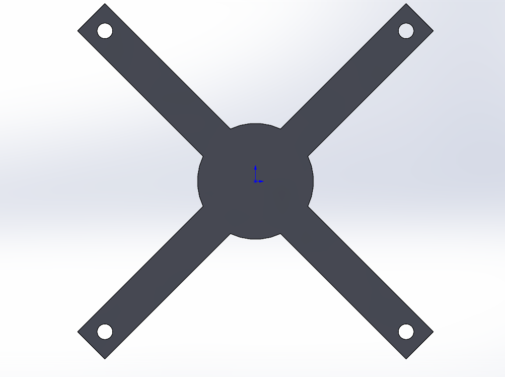
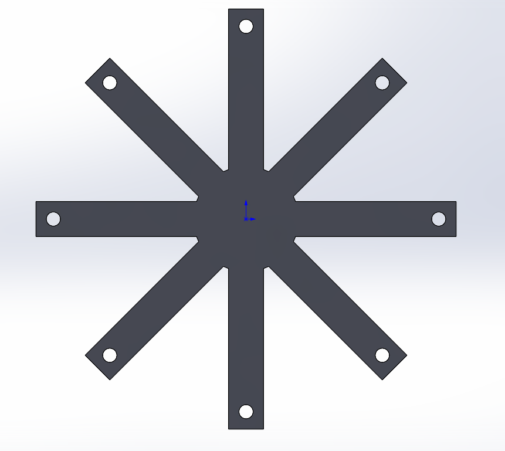

# Quadcopter Frame Generator

Учебный проект: Python-скрипт, который по параметрам автоматически строит в SolidWorks плоскую раму квадрокоптера (или мультикоптера с любым числом лучей) и сохраняет её в файл `.SLDPRT`.

## Примеры

Рама с 4 лучами (X-схема):



Рама с 8 лучами:



Обе рамы построены одной и той же функцией, менялись только числа в вызове.

## Что делает скрипт

- создаёт новую деталь через SolidWorks API
- строит центральную круглую пластину
- строит заданное число лучей, каждый под своим углом
- делает отверстие под мотор на конце каждого луча
- сохраняет деталь в папку `C:\sw_project\parts`

## Параметры

Функция `make_frame(name, n_arms, arm_length, arm_width, center_d, thickness, start_angle, hole_d)`. Размеры в метрах, угол в градусах.

| Параметр | Что означает |
|----------|--------------|
| `name` | имя файла без расширения |
| `n_arms` | количество лучей |
| `arm_length` | длина луча от центра |
| `arm_width` | ширина луча |
| `center_d` | диаметр центральной пластины |
| `thickness` | толщина рамы |
| `start_angle` | угол первого луча (45 даёт X-схему, 0 даёт плюс) |
| `hole_d` | диаметр отверстия под мотор |

## Требования

- Windows
- SolidWorks (проверено на версии 2022)
- Python 3
- библиотека pywin32: `python -m pip install pywin32`

## Запуск

1. Запустить SolidWorks.
2. В командной строке выполнить:

```
python drone_frame.py
```

## Пример вызова

```python
make_frame("frame_1", 4, 0.12, 0.02, 0.06, 0.003, 45, 0.008)
```

Получится рама с 4 лучами по 120 мм, центральной пластиной 60 мм, толщиной 3 мм и отверстиями 8 мм.

## Ограничения

- диаметр отверстия `hole_d` должен быть меньше ширины луча `arm_width`
- при большом числе лучей и маленьком центре лучи сильно накладываются друг на друга
- деталь строится плоской, без рёбер жёсткости и крепления электроники

## Чему научился на проекте

- построение геометрии по формулам: повороты через синус и косинус
- разбиение кода на функции
- управление SolidWorks из Python (pywin32)
- параметрическое моделирование
